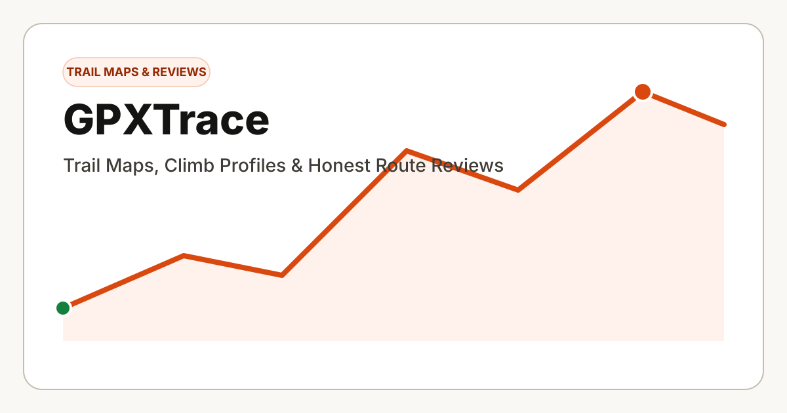

# GPXTrace

**Live Site:** [https://punpundada.github.io/gpxtrace/](https://punpundada.github.io/gpxtrace/)



**GPXTrace** is a static GPS trail and cycling review blog paired with a client-side GPX telemetry studio. Built with **Astro** (`output: 'static'`) and **Leaflet**, it combines automated route diagnostics from raw `.gpx` recordings with written field notes—requiring zero backend servers or map API keys.

---

## Key Features

- **Dual-Review Architecture**
  - **Automated GPX Track Review**: Parses `<trkpt>` and `<rtept>` XML coordinates to compute Haversine distance, elevation gain/loss (with a `1.5m` barometric noise floor), moving time, average speed, a 4-tier gradient steepness distribution (`<3%` Flat, `3–8%` Rolling, `8–15%` Steep, `>15%` Extreme), automatic crux climb pitch detection (`km start → end`, average grade, climb gain), and a `1–100` Effort Index.
  - **Written Editorial Review**: Pairs the telemetry with an author star rating (`1.0–5.0`), trailhead metadata, surface/season/water/gear callouts, and long-form Markdown field notes.
- **Synchronized Map & Elevation Cockpit**
  - Interactive **Leaflet** map with one-click switching between **OpenStreetMap** and **OpenTopoMap** (contour lines).
  - Scrubbing across the SVG elevation profile moves a synchronized position marker along the map polyline and updates live distance, altitude, gradient, and coordinate readouts.
- **Interactive GPX Upload Studio (`/upload`)**
  - Drag and drop any `.gpx` file directly in the browser to plot the route on OpenStreetMap, inspect its automated telemetry review, draft a trail review with a live preview sidebar, save it to browser storage (`localStorage`), or export a ready-to-commit `.md` blog post.
- **Metric & Imperial Unit Toggle (`KM / M` ↔ `MI / FT`)**
  - Instant client-side conversion across all telemetry cards, crux climb ranges, track cards, and elevation chart readouts.
- **Responsive & Accessible**
  - Responsive layout tested from `320px` mobile viewports through tablet (`768px`) and desktop (`1440px`), with WCAG AA/AAA contrast and `tabular-nums` numeric alignment.
- **Search Engine Optimization (SEO)**
  - Canonical URLs, Open Graph & Twitter Card tags, dynamic build-time `/sitemap.xml`, `robots.txt`, and rich JSON-LD structured data (`WebSite`, `ItemList`, `Article`, `Place`/`GeoCoordinates`, `Review`/`Rating`, and `BreadcrumbList`).

---

## Tech Stack

| Layer | Technology | Purpose |
| :--- | :--- | :--- |
| **Static Framework** | [Astro 5](https://astro.build/) (`output: 'static'`) | Build-time static HTML generation & Zod-validated Content Collections |
| **Interactive Mapping** | [Leaflet 1.9](https://leafletjs.com/) | OpenStreetMap & OpenTopoMap raster tile rendering and polyline overlays |
| **Telemetry & UI Logic** | TypeScript (Vanilla ES Modules) | Client-side & build-time GPX XML parsing, crux detection, unit conversion |
| **Styling** | Modular CSS (`src/styles/`) | Custom design tokens (`tokens.css`, `components.css`, `cockpit.css`, `editorial-studio.css`, `responsive.css`) |
| **Testing** | Node `tsx` + Chrome DevTools Protocol | Unit tests (`gpx.test.ts`) & headless Chrome E2E/responsive suite (`e2e-browser.ts`) |

---

## Quick Start

```bash
# Install dependencies
npm install

# Start local development server at http://localhost:4321
npm run dev

# Run GPX parser & security unit tests
npm test

# Build static production site into dist/
npm run build

# Preview production build locally
npm run preview

# Run headless Chrome E2E & responsive viewport suite (requires Chrome/Chromium)
npm run test:e2e
```

---

## How to Publish a New Track

Because GPXTrace compiles to static HTML/CSS/JS, permanent tracks live in the repository as a pair of files:
1. The raw GPS recording in `public/gpx/<your-track>.gpx`
2. The Markdown review in `src/content/tracks/<your-track>.md`

### Option 1: Using the `/upload` Studio UI (Recommended)

1. Run `npm run dev` and open `http://localhost:4321/upload` (or use your deployed `/upload` page).
2. Drop your `.gpx` file into the upload dropzone. The map and automated review panel will update immediately.
3. Fill in the **Write Your Trail Dispatch** form (headline, subtitle, location, activity, difficulty, rating, surface, best season, water notes, gear callout, summary, and Markdown body).
4. Click **Download .MD Blog Post** to download the formatted `<slug>.md` file.
5. Place your `.gpx` file and downloaded `.md` file into the repository:
   ```text
   public/gpx/my-new-trail.gpx
   src/content/tracks/my-new-trail.md
   ```
6. Run `npm run build` (or `git commit && git push` to trigger your static host). Astro will automatically generate `/tracks/my-new-trail/`, add a card to the home feed, and include the URL in `/sitemap.xml`.

### Option 2: Creating the Markdown File Manually

Create `src/content/tracks/<slug>.md` with the following frontmatter schema (validated by [`src/content.config.ts`](./src/content.config.ts)):

```markdown
---
title: "Hampta Pass Crossover: 14.2 km & +1,120m Alpine Dispatch"
subtitle: "From lush Kullu valley meadows over the 4,270m boulder pass into Lahaul."
date: "2026-10-20"
location: "Manali, Himachal Pradesh"
activity: "Alpine"          # "Hiking" | "Trail Run" | "Gravel Cycling" | "Alpine"
difficulty: "Hard"          # "Easy" | "Moderate" | "Hard" | "Expert"
rating: 4.9                 # Number between 1.0 and 5.0
gpxFile: "hampta-pass.gpx"  # Must match the filename in public/gpx/
surface: "Glacial moraine, wet boulders, and high-altitude snowfields"
bestSeason: "June – Mid October"
waterNotes: "Reliable stream crossings up to Jwara camp; carry 2L for the pass push"
gearCallout: "Waterproof mid-cut boots, trekking poles, and windproof shell"
summary: "A dramatic high-altitude crossover linking the green Kullu valley to the stark Lahaul desert."
featured: false             # Set true to feature in the home page hero cockpit
---

## How the Track Feels Underfoot

Write your full trail review in standard Markdown here...
```

---

## Project Structure

```text
gpxtrace/
├── public/
│   ├── favicon.svg                 # Topographic contour + route trace favicon
│   ├── og-card.svg                 # Open Graph social sharing preview card
│   ├── robots.txt                  # Crawler rules & sitemap pointer
│   └── gpx/                        # Raw .gpx XML files served statically & parsed at build time
│       ├── kudremukh-trail.gpx
│       ├── nandi-hills-climb.gpx
│       └── triund-ridge.gpx
├── src/
│   ├── components/
│   │   ├── AutomatedReviewPanel.astro  # Computed telemetry cards, crux pitch & gradient bar
│   │   ├── Header.astro                # Sticky header, navigation & KM/MI unit toggle
│   │   ├── Icon.astro                  # Central SVG stroke icon library
│   │   ├── ReviewEditorForm.astro      # Written review form & live preview sidebar for /upload
│   │   ├── TrackCard.astro             # Home feed card with route silhouette SVG
│   │   └── TrackMap.astro              # Leaflet map + synchronized SVG elevation chart cockpit
│   ├── config/
│   │   └── site.ts                 # Centralized site constants, thresholds, tile URLs & units
│   ├── content/
│   │   └── tracks/                 # Markdown trail reviews (Astro Content Collection)
│   ├── layouts/
│   │   └── BaseLayout.astro        # HTML shell, SEO meta tags, Open Graph & JSON-LD
│   ├── lib/
│   │   ├── custom-reviews.ts       # Browser localStorage persistence & .md file export
│   │   ├── e2e-browser.ts          # Headless Chrome E2E & responsive viewport test suite
│   │   ├── gpx-svg.ts              # SVG path projection for elevation profile & silhouettes
│   │   ├── gpx.test.ts             # Unit tests for GPX parsing, crux detection & XSS escaping
│   │   ├── gpx.ts                  # GPX XML parser, Haversine math, gradient & crux engine
│   │   ├── map-controller.ts       # Leaflet map lifecycle & elevation scrub controller
│   │   ├── tracks-loader.ts        # Build-time loader pairing Markdown entries with .gpx files
│   │   ├── units.ts                # Metric/Imperial unit state & DOM formatter
│   │   └── upload-studio.ts        # Client controller for the /upload interactive studio
│   ├── pages/
│   │   ├── index.astro             # Home page: featured track cockpit + filterable dispatch grid
│   │   ├── sitemap.xml.ts          # Dynamic build-time XML sitemap generator
│   │   ├── upload.astro            # Interactive GPX upload & review studio page
│   │   └── tracks/
│   │       └── [slug].astro        # Individual track review page (automated + written review)
│   └── styles/
│       ├── design-system.css       # Entry stylesheet importing modular CSS layers
│       ├── tokens.css              # CSS custom properties, typography & layout primitives
│       ├── components.css          # Header, buttons, badges, hero, cards, filter bar & toast
│       ├── cockpit.css             # Map frame, elevation dock, telemetry grid & gradient bar
│       ├── editorial-studio.css    # Prose typography, verdict sidebar, dropzone & form styles
│       └── responsive.css          # Tablet (<=1024px) & Mobile (<=640px) media queries
├── astro.config.mjs
├── package.json
└── tsconfig.json
```

---

## Configuration & Deployment

1. **Set Your Production Domain**:
   Update `siteUrl` in [`src/config/site.ts`](./src/config/site.ts) and `site` in [`astro.config.mjs`](./astro.config.mjs) (plus the `Sitemap:` line in [`public/robots.txt`](./public/robots.txt)) to your production domain so canonical links, Open Graph URLs, and `/sitemap.xml` point to your live host.
2. **Deploy Anywhere**:
   Run `npm run build` and deploy the static `dist/` folder to **Cloudflare Pages**, **Netlify**, **Vercel**, **GitHub Pages**, or any static file server.
